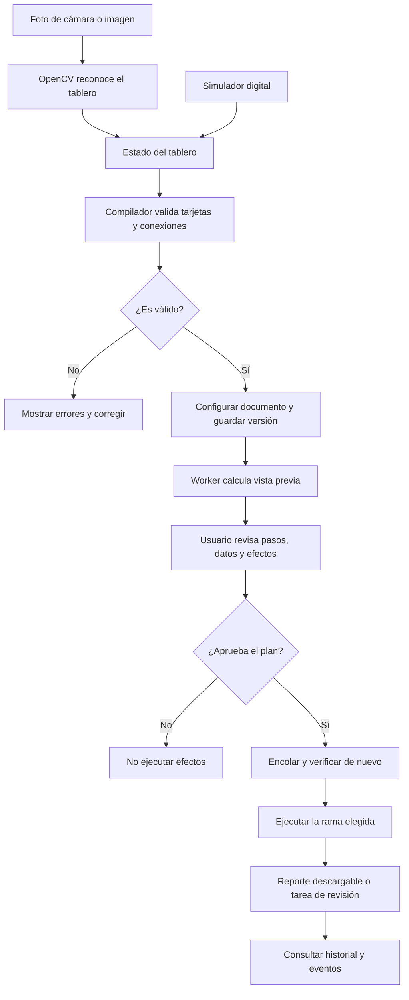

# Cómo funciona Tactiloom y cómo debería funcionar

Este documento explica el funcionamiento actual del programa y el comportamiento esperado de su versión 1. También distingue las tareas pendientes de las mejoras opcionales.

Está basado en el código, los contratos y las especificaciones del repositorio. Las evidencias de pruebas ya registradas se encuentran en [Estado de implementación](implementation-status.md); este documento no representa una nueva ejecución de esas pruebas.

## 1. Qué hace el programa

Tactiloom permite construir un procedimiento colocando tarjetas sobre un tablero físico. Cada tarjeta representa una acción, y su posición y orientación determinan cómo se conecta con las demás.

El programa fotografía o recibe una imagen del tablero, reconoce las tarjetas y convierte su disposición en un flujo de trabajo. Después permite configurar los documentos, revisar qué ocurrirá y autorizar la ejecución.

El caso de uso implementado es procesar solicitudes de inscripción a un taller:

- Leer un PDF con texto seleccionable o un archivo TXT.
- Extraer nombre, correo y taller.
- Comprobar los campos obligatorios.
- Generar y guardar un reporte si la solicitud es válida.
- Registrar una tarea de revisión si faltan datos o el correo obligatorio es inválido.

**Reconocer o mover tarjetas nunca inicia por sí solo la ejecución.** Los efectos del flujo requieren una vista previa y una aprobación explícita.

El nombre actual del producto es **Tactiloom**. El documento original del proyecto utiliza el nombre provisional *RitualOS*.

## 2. Recorrido completo



### Paso 1: obtener el tablero

Hay tres modos de entrada:

| Modo | Cómo funciona actualmente |
|---|---|
| Cámara (`physical`) | El usuario activa la cámara y pulsa capturar. Se envía una foto JPEG para analizarla. |
| Imagen (`image`) | El usuario sube una imagen JPG, PNG o WEBP, o elige una imagen de la galería. |
| Simulador (`simulator`) | El usuario coloca y gira tarjetas digitales. Se genera el estado del tablero sin utilizar cámara ni OpenCV. |

Las imágenes de la galería son **sintéticas**: se generan a partir del kit imprimible y se procesan realmente con OpenCV. No son fotografías de pruebas físicas.

### Paso 2: reconocer las tarjetas

El servicio de visión busca marcadores **ArUco**, pequeños patrones cuadrados que identifican las tarjetas y las esquinas del tablero. No necesita leer el texto impreso en las tarjetas.

El tablero tiene **8 columnas y 4 filas**. Los cuatro marcadores de esquina, con IDs `0` a `3`, permiten corregir la perspectiva de la imagen. Después, el detector calcula la casilla y la orientación de cada tarjeta.

La salida incluye los IDs reconocidos, posiciones, orientaciones, diagnósticos y una imagen con anotaciones para comprobar qué interpretó el sistema. Si faltan esquinas o una tarjeta tiene una posición u orientación ambigua, se informa el problema y se bloquea la compilación válida.

Las fotos y la imagen anotada no se persisten como parte de la captura; se guardan los datos estructurados del reconocimiento. La respuesta de análisis sí permite mostrar las anotaciones en el navegador.

### Paso 3: convertir el tablero en un programa

El compilador toma el estado del tablero y los parámetros de sus tarjetas. Usa el catálogo del servidor para determinar qué significa cada ID y construye un grafo: las tarjetas son los pasos y las conexiones indican el orden de ejecución.

Antes de producir un programa válido comprueba, entre otras reglas:

- Existe exactamente un INICIO y al menos un FIN.
- Cada tarjeta ocupa una casilla y cada instancia aparece una sola vez.
- Las salidas conectan con tarjetas vecinas correctamente orientadas.
- No hay ciclos, entradas múltiples ni tarjetas inalcanzables desde INICIO.
- Todos los caminos terminan en FIN.
- Cada acción dispone de los datos que necesita; por ejemplo, EXTRAER TEXTO requiere un documento y GUARDAR REPORTE requiere un reporte generado.
- El flujo no supera los 30 nodos.

Si hay errores, la interfaz puede mostrar el grafo interpretado y los diagnósticos, pero no permite ejecutar esa versión. Si todo es válido, se produce una representación del programa llamada **IR**, con versión `tactiloom-ir/1`.

La web recompila en el servidor al guardar una versión; no utiliza como programa ejecutable una IR proporcionada por el navegador.

### Paso 4: configurar y guardar una versión

En Workflow Studio se selecciona el documento de entrada y se configuran los parámetros disponibles: campos obligatorios, formato e idioma del reporte, nombre de descarga y etiqueta de revisión.

El tablero define la estructura del flujo; esos parámetros se configuran en la interfaz. Por ejemplo, la tarjeta ARCHIVO identifica el paso de lectura, pero no contiene físicamente el documento que se procesará.

Cada guardado crea una versión inmutable. Cambiar el documento o los parámetros requiere guardar otra versión para revisar y ejecutar ese nuevo programa. Una versión inválida puede conservarse para consultar sus diagnósticos, pero no ejecutarse.

### Paso 5: calcular la vista previa

Al solicitar el **dry-run**, el servidor crea una ejecución y un trabajo `PREVIEW` en PostgreSQL. El runner procesa el documento real y calcula:

- Qué archivo se leerá y cuál es su huella SHA-256.
- Qué pasos se recorrerán y qué rama se elegirá.
- Qué campos se encontraron, cuáles faltan y cuáles son inválidos.
- Qué reportes o tareas de revisión se crearían.
- Una vista previa del reporte Markdown, cuando corresponde.

En esta fase se registran el plan y los eventos de la vista previa, pero no se guardan los reportes finales ni se crean tareas de revisión. Si falla la lectura del documento, tampoco se obtiene un plan aprobable.

### Paso 6: aprobar y ejecutar

El usuario revisa el plan, marca la confirmación y pulsa aprobar. La API exige `confirm: true` y comprueba dos huellas:

| Huella | Qué identifica |
|---|---|
| `contentHash` | La estructura y los parámetros del programa compilado. |
| `planHash` | El plan calculado para ese programa y documento: entrada, recorrido, validación y efectos previstos. |

La vista previa se puede aprobar durante **30 minutos**. Además, el runner rechaza una ejecución todavía en cola si ha pasado más de **una hora desde la aprobación**.

Antes de producir efectos, el runner vuelve a validar el programa y recalcula el plan sin efectos. Si no coincide con el aprobado, la ejecución falla y se debe repetir la revisión.

El `contentHash` refleja el significado del programa. Cambiar una conexión o un parámetro puede cambiarlo; trasladar todo el flujo conservando las mismas conexiones no lo cambia. El modo de entrada tampoco forma parte de esta huella.

### Paso 7: consultar el resultado

El motor recorre únicamente la rama seleccionada. Registra eventos por nodo y genera los resultados correspondientes:

- **Solicitud válida:** archivos Markdown y/o JSON descargables, según la configuración.
- **Solicitud que requiere revisión:** una tarea `OPEN` con los campos faltantes o inválidos.

PEDIR REVISIÓN registra una tarea en la base de datos; no envía correos ni notificaciones. La interfaz permite consultar esa tarea en el resultado y el historial.

El monitor muestra el estado, los eventos, los errores y los resultados. Las descargas comprueban que el artefacto pertenece al workspace de la sesión y que su contenido coincide con el checksum registrado.

## 3. Qué hace cada tarjeta

El catálogo contiene **nueve tipos de tarjeta**. Puede haber varias instancias físicas de un mismo tipo con IDs distintos.

| Tarjeta | Identificador | Función |
|---|---|---|
| INICIO | `START` | Define el punto de entrada del flujo. |
| ARCHIVO | `INPUT_FILE` | Lee un documento previamente subido al workspace. |
| EXTRAER TEXTO | `EXTRACT_TEXT` | Obtiene texto de TXT o de la capa de texto de un PDF. |
| VALIDAR CAMPOS | `VALIDATE_FIELDS` | Extrae los campos reconocidos y comprueba los obligatorios y el formato del correo obligatorio. |
| CONDICIÓN | `CONDITION` | Elige SÍ o NO según el resultado de la validación. |
| CREAR REPORTE | `CREATE_REPORT` | Prepara el contenido Markdown y/o JSON en memoria. |
| GUARDAR REPORTE | `SAVE_REPORT` | Guarda ese contenido como archivos descargables en el workspace. |
| PEDIR REVISIÓN | `REQUEST_REVIEW` | Crea una tarea de revisión con los problemas detectados. |
| FIN | `END` | Termina el camino recorrido. |

La extracción de campos usa reglas deterministas sobre líneas como `Nombre: Ana Ejemplo`. Reconoce etiquetas en español, inglés, italiano y francés. No interpreta libremente cualquier documento mediante IA ni aplica OCR.

## 4. Cómo se conectan las tarjetas

La flecha impresa indica la dirección de avance de una tarjeta: norte, este, sur u oeste.

1. Una tarjeta normal envía el flujo a la casilla inmediata hacia su flecha.
2. La receptora debe admitir entrada por su parte posterior y tener la orientación compatible con esa conexión.
3. CONDICIÓN envía **SÍ hacia su flecha** y **NO a la derecha respecto a esa flecha**.
4. FIN admite entrada y no tiene salida; INICIO tiene salida y no admite entrada.

No se conectan tarjetas a través de espacios vacíos ni mediante líneas dibujadas. Girar una tarjeta no crea automáticamente un codo: debe seguir siendo compatible con la salida que recibe.

Ejemplo oficial, usando coordenadas `(fila, columna)` desde cero:

| Fila | Colocación |
|---|---|
| `0` | INICIO → ARCHIVO → EXTRAER TEXTO → VALIDAR CAMPOS → CONDICIÓN → CREAR REPORTE → GUARDAR REPORTE → FIN, en columnas `0` a `7`, todas orientadas al este. |
| `1` | PEDIR REVISIÓN en `(1,4)`, orientada al sur. Recibe la rama NO de CONDICIÓN. |
| `2` | FIN en `(2,4)`, orientada al sur. Termina la rama de revisión. |

Este tablero produce **10 nodos y 9 conexiones**. La [gramática física](physical-grammar-v1.md) contiene las reglas completas.

## 5. Cómo está organizado internamente

| Componente | Responsabilidad |
|---|---|
| `apps/web/` | Interfaz Next.js y API HTTP: sesiones, análisis, compilación, versiones, aprobación, historial y descargas. |
| `services/vision/` | FastAPI y OpenCV: transforma imágenes en detecciones y estados del tablero. No ejecuta flujos. |
| `packages/contracts/` | Define estructuras y validaciones compartidas, catálogo y JSON Schemas. |
| `packages/compiler/` | Convierte el tablero en IR y comprueba sus reglas. |
| `packages/workflow-engine/` | Implementa las acciones, la extracción documental, los planes y el acceso seguro a archivos. |
| `apps/runner/` | Procesa los trabajos de vista previa y ejecución fuera del servidor web. |
| `packages/db/` y `prisma/` | Cliente Prisma, modelo de datos, migraciones y datos iniciales. |
| PostgreSQL | Conserva sesiones y workspaces, capturas estructuradas, versiones, trabajos, ejecuciones, eventos, artefactos, revisiones y auditoría. |
| `packages/board-kit/` | Genera el tablero y las tarjetas imprimibles en PDF y SVG. |

Los documentos subidos y los reportes se almacenan en disco bajo `WORKSPACE_ROOT/<workspaceId>/`; PostgreSQL guarda sus metadatos y huellas. La web gestiona las subidas y el runner escribe los reportes.

Un **workspace** es el espacio de trabajo aislado asociado a la sesión. La experiencia actual utiliza sesiones de demostración con cuotas y caducidad configurables; `.env.example` establece 24 horas. El runner limpia los workspaces vencidos, por lo que el historial y los archivos de la demo son temporales.

La cola usa la tabla `Job`, bloqueos `FOR UPDATE SKIP LOCKED` y una reserva temporal renovada por el worker. Un trabajo cuya reserva caduca puede recuperarse. Las claves únicas y las escrituras idempotentes evitan duplicar reportes o revisiones durante los reintentos; no se promete que cada trabajo se procese una sola vez.

## 6. Estados de una ejecución

| Estado | Significado |
|---|---|
| `DRAFT` | Se solicitó una vista previa y el trabajo está pendiente de procesarse. |
| `COMPILED` | El runner verificó el programa y está preparando la vista previa. |
| `AWAITING_APPROVAL` | El plan está listo y espera aprobación. |
| `QUEUED` | El usuario aprobó el plan y la ejecución está en cola. |
| `RUNNING` | El worker está ejecutando el programa. |
| `SUCCEEDED` | Terminó el recorrido y se verificaron los resultados exigidos por los pasos ejecutados. |
| `FAILED` | Una validación o acción falló; se registra el motivo. |
| `CANCELLED` | La ejecución terminó por cancelación. |

El recorrido normal es `DRAFT → COMPILED → AWAITING_APPROVAL → QUEUED → RUNNING → SUCCEEDED`. Un fallo o una cancelación pueden interrumpirlo.

La cancelación durante el procesamiento es cooperativa: el motor la comprueba entre nodos. No implica deshacer automáticamente los archivos o tareas que ya se hayan creado.

## 7. Cómo debería funcionar: criterios de aceptación

Estos criterios describen la conducta esperada de la versión 1. El código ya implementa el flujo principal; los pendientes de validación y entrega se detallan en la sección siguiente.

| Situación | Resultado esperado |
|---|---|
| Se analiza el tablero oficial válido. | Se reconocen sus 10 tarjetas y se obtiene el grafo de dos ramas. |
| Falta una esquina, una tarjeta queda entre casillas o tiene orientación ambigua. | Se explica el problema y se bloquea la ejecución de ese tablero. |
| Hay una salida sin receptor, un ciclo o una acción sin los datos necesarios. | El compilador devuelve diagnósticos con tarjeta, casilla y sugerencia cuando corresponde. |
| El flujo compila, pero ARCHIVO no tiene documento. | Se permite configurar o guardar el flujo, pero no generar una vista previa ejecutable. |
| Se solicita una vista previa. | Se lee la entrada y se muestran los efectos previstos sin guardar reportes finales ni crear revisiones. |
| Se intenta ejecutar sin aprobación, con hashes distintos o con una vista previa caducada. | Se rechaza la solicitud. |
| Cambia el documento respecto al aprobado o el runner calcula otro plan. | Se detiene la ejecución y se exige una nueva revisión. |
| Se procesa `valid-application.pdf` con el ejemplo oficial y sus parámetros por defecto. | Se toma SÍ y se generan un reporte Markdown y otro JSON descargables. |
| Se procesa `invalid-application.pdf` con ese mismo flujo. | Se toma NO, se registra una revisión `OPEN` y no se genera reporte. |
| Se intenta leer un PDF escaneado sin texto. | Falla la extracción con `PDF_NO_TEXT_LAYER`; se solicita un PDF con texto o un TXT. |
| Se reintenta un trabajo tras una caída. | Se recupera según sus límites de reintento y se evitan efectos duplicados. |
| Se consulta un recurso de otro workspace. | Se impide el acceso. |
| Se usa el simulador o la galería. | Se identifica el origen correctamente: simulación digital o imagen sintética. |
| Se cambia el idioma de la interfaz. | Se muestran los textos disponibles en español, inglés, italiano o francés; el reporte sigue su propio parámetro de idioma. |

## 8. Qué falta y qué sería una mejora futura

| Aspecto | Estado actual | Qué debería hacerse |
|---|---|---|
| Pruebas físicas | Hay detector, kit y pruebas sintéticas; no hay resultados físicos registrados en el repositorio. | Imprimir el kit, capturar con cámara real y registrar resultados por iluminación, perspectiva y dispositivo en [Benchmark de visión](benchmarking.md). |
| Validación de uso | La evaluación exploratoria con personas sigue pendiente. | Medir si pueden construir el flujo, corregir errores y comprender la aprobación. |
| Despliegue público | Existe configuración Docker y una guía; la documentación registra la publicación como pendiente. | Desplegar con HTTPS y comprobar el recorrido completo desde una URL accesible. |
| Entrega del proyecto | Hay guías y guion; la documentación registra el repositorio público y el vídeo como pendientes. | Publicar las evidencias y actualizar los enlaces de entrega. |
| Cámara continua | Hoy se analiza una foto por captura. | Como mejora opcional, analizar a baja frecuencia y estabilizar el tablero con varias observaciones coincidentes. |
| Importación/exportación de flujos | La función de intercambio de flujos JSON figura como pendiente opcional. | Definir y validar ese intercambio versionado; es distinto de descargar un reporte JSON. |
| OCR | No está implementado ni forma parte del procesamiento actual. | Si se amplía el alcance, añadir reconocimiento de documentos escaneados y reflejar sus límites en la vista previa. |

El objetivo experimental documentado para las pruebas físicas es reconocer correctamente los 10 nodos del ejemplo en al menos 8 de 10 capturas controladas. Es una meta pendiente de medir, no un resultado obtenido.

La versión 1 se limita al catálogo de acciones descrito: no admite bucles, uniones de ramas `MERGE`, código arbitrario ni automatización general del sistema operativo. Ampliar esas capacidades requeriría nuevos contratos, reglas de compilación y pruebas.

## 9. Cómo ponerlo en marcha y comprobarlo

La opción más directa es ejecutar el stack con Docker:

```bash
cp .env.example .env
# Editar .env: POSTGRES_PASSWORD, SESSION_SECRET y VISION_INTERNAL_TOKEN.
# Usar la misma contraseña de PostgreSQL en DATABASE_URL y TEST_DATABASE_URL.
docker compose up --build
```

Abrir **http://localhost:3210**. El servicio de migración prepara la base de datos y carga el catálogo antes de iniciar la web y el runner. Para desarrollo local se requieren Node.js 24+, pnpm 11.9.0 y Python 3.12+; los pasos están en el [README](../README.md).

Comprobación funcional sin cámara:

1. Entrar a Galería y analizar el tablero válido en perspectiva.
2. Comprobar las 10 tarjetas y guardar la versión.
3. Abrir Workflow Studio y seleccionar `valid-application.pdf` si no está seleccionado.
4. Guardar los cambios, solicitar el dry-run y revisar entrada, rama y efectos.
5. Aprobar y comprobar que termina en `SUCCEEDED` con los dos reportes descargables.
6. Seleccionar `invalid-application.pdf`, guardar otra versión y repetir la revisión y aprobación.
7. Comprobar que esa ejecución genera una revisión `OPEN`.
8. Analizar un tablero inválido y comprobar que los diagnósticos impiden ejecutarlo.

Comandos de verificación disponibles:

| Comando | Qué comprueba |
|---|---|
| `pnpm typecheck` | Tipos de TypeScript. |
| `pnpm lint` | Reglas de ESLint y Ruff. |
| `pnpm test` | Pruebas unitarias y de propiedades de TypeScript y Python. |
| `pnpm test:integration` | Cola, runner, persistencia y aislamiento con PostgreSQL. Requiere `TEST_DATABASE_URL` con una base terminada en `_test`. |
| `pnpm test:e2e` | Recorridos de navegador contra el stack activo, con Chrome del sistema y ffmpeg para la cámara falsa. |
| `node scripts/smoke.mjs http://localhost:3210` | Recorrido básico de las dos ramas y rechazo de un tablero ambiguo. |

## 10. Referencias del repositorio

- [README e instalación](../README.md).
- [Requisitos y criterios de aceptación](../.kiro/specs/tactiloom/requirements.md).
- [Estado de implementación y evidencias](implementation-status.md).
- [Gramática del tablero](physical-grammar-v1.md).
- [Representación del programa y plan](workflow-ir-v1.md). Para los parámetros actuales de idiomas, consultar también [su definición en código](../packages/contracts/src/params.ts).
- [API HTTP](api.md).
- [Arquitectura](adr/0001-architecture.md).
- [Manual de impresión y montaje](../assets/board-kit/ASSEMBLY.md).
- [Guía para probar la demo](judge-guide.md).
